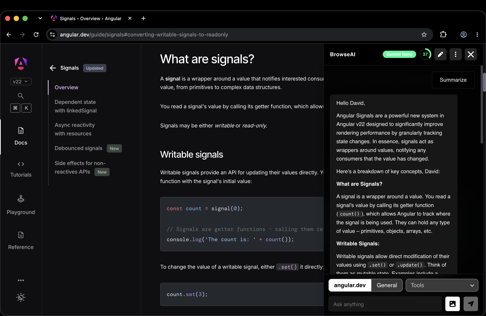
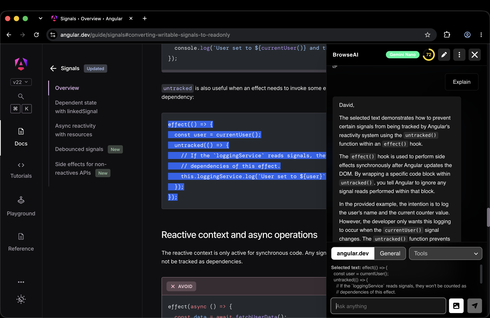
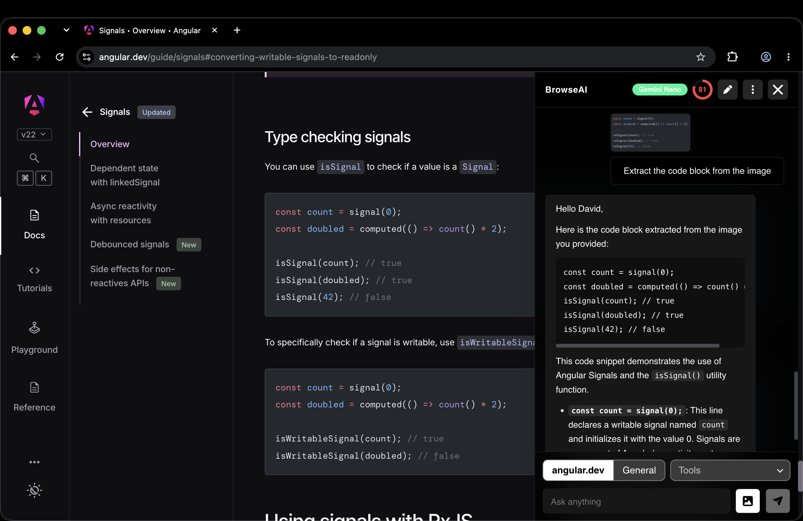
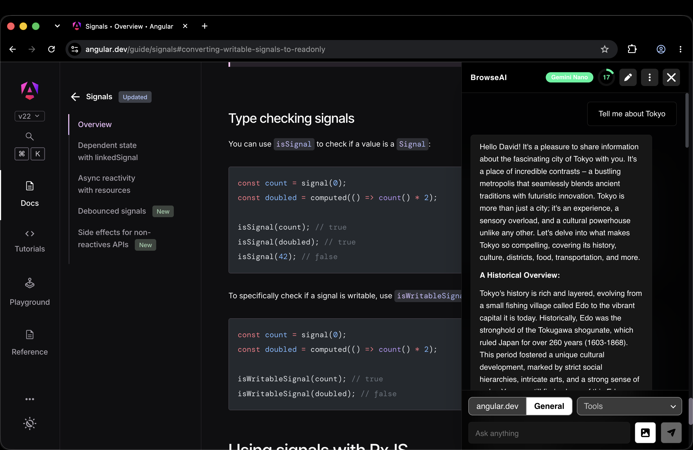
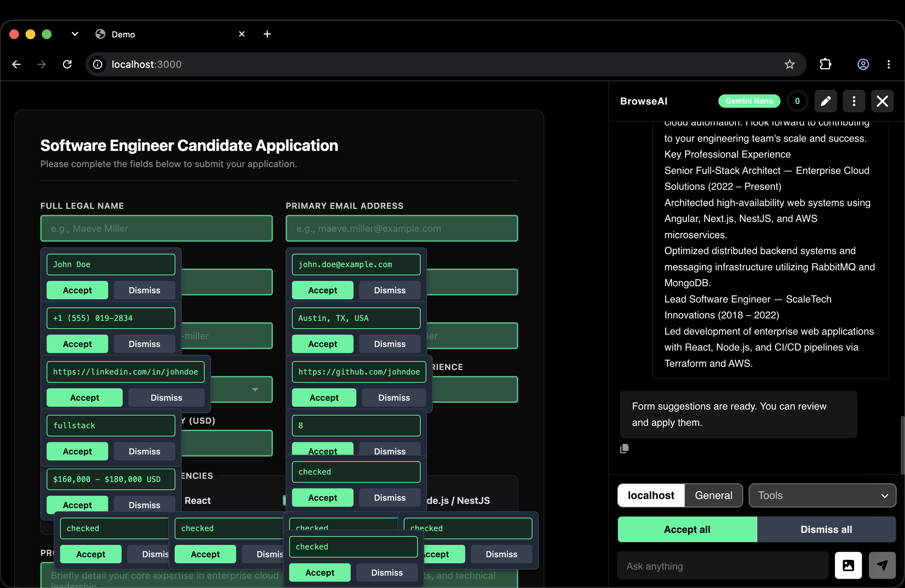

# BrowseAI

[](https://youtu.be/c3ZOUwcaTu0)

Watch the [demo on YouTube](https://youtu.be/c3ZOUwcaTu0).

Install it from the
[Chrome Web Store](https://chromewebstore.google.com/detail/browseai/dgbhpfghmnipbilehfelfliihmgombch).

A Chrome extension that adds an AI chat to every web page. It runs on Chrome's
built-in model (Gemini Nano), so pages and prompts stay on your device.

The chat itself is the
[browse-ai-core](https://www.npmjs.com/package/browse-ai-core) npm package. This
repo only wires it into Chrome:

- `src/main.ts` and `src/content/`: the content script. It adds a
  `<browse-ai-extension>` element to the page and mounts the chat in it with the
  extension settings from `src/content/extension-config.ts`.
- `src/background/`: the service worker. It takes screenshots of the tab when
  the chat asks for one.
- `public/`: `manifest.json` and the toolbar popup.

To change how the chat looks or works, change the package, publish it, and
update the version here.

## Features

### Chat

- Ask about the page you're on, or switch to General to chat without the page.
  In page mode the chat reads the page title, URL and text.
- Select text on the page and it's sent with your next question.
- Answers appear as they're written and can be copied. A running answer can be
  stopped. New chat starts over.
- A badge in the header shows how much of the model's memory the chat has used.
- If Gemini Nano isn't on the computer yet, the chat shows a button to download
  it, with progress.

### Attachments and voice

- Add an image or an audio file to a question.
- Capture visible area: attach a screenshot of what you see on the page.
- Snip and capture: drag a box on the page and attach only that part.
- Mic button: speak your question instead of typing it. The text goes into the
  input so you can fix it before sending. Recordings stop after 60 seconds.

### Tools

Pick a tool in the Tools menu under the input. Tools are grouped by what they
do. When you pick one, a green box shows the steps to use it.

Forms

- Form Filler: paste your details, like a resume, and it suggests a value for
  each field of the form on the page. Accept or dismiss each one.
- Form Validator: checks the form before you send it. Fields with problems are
  marked on the page with a short explanation. A mark goes away when the field
  is fixed.

Read and understand

- Summarizer: sums up the text you give it.
- Translator: translates text to the language you pick.
- Argument Mapper: shows the main claim of an article with the points for and
  against it. Show on page jumps to a point in the text.
- Review Summarizer: reads the reviews on a product page and gives pros, cons,
  common complaints and a rating breakdown.
- Subject Finder: describe what you're looking for and the page scrolls to it.
- Link Inspector: lists all links on the page in groups (same site, other sites,
  downloads, email and phone, suspicious), or finds the link you ask for.

Write

- Writer: writes text for a task you describe, like an email.
- Rewriter: rewrites the text you give it.
- Proofreader: fixes grammar and spelling.
- Reply Drafter: click a comment or message box on the page, pick a tone and
  length, and it drafts a reply. Insert puts the reply in the box.
- Dictation: click a text box on the page, then speak. What you say is typed
  into the box.

Save and extract

- Notes: makes short notes for the whole page and saves them.
- Research Notes: add the pages you read to a topic, then ask questions across
  all of them. Answers list the pages they came from.
- Tables Extractor: downloads the tables on the page as CSV, Excel, JSON or
  Markdown, in one zip.
- Image Downloader: finds the images on the screen that match what you describe
  and downloads them as a zip.

Safety

- Scam Check: looks for signs of phishing or a scam on the page and gives a low,
  medium or high risk level with the reasons.
- Dark Pattern Detector: finds tricks like pre-checked extras, countdown timers,
  "only 2 left" claims and hidden "no" buttons, and marks them on the page.
  Pre-checked boxes can be unchecked from the chat.

Developer

- Performance Explainer: shows how fast the page is with live charts that update
  every second, and explains the biggest problems.

Summarizer, Translator, Writer, Rewriter and Proofreader use Chrome's own models
for these tasks. Each one shows a download button the first time.

DOM Element to Component (turn a page element into component code) is in the
package but turned off in the extension.

### Selected text

When you select text on a page, a small bar appears next to it with Summarize,
Translate, Write, Rewrite and Proofread (for the models you've downloaded) and
Save note.

### Notes

- Save note keeps the selected text with a short AI note about it. The text
  stays highlighted when you open the page again. Click the highlight to see the
  note.
- Open Notes from the menu at the top of the chat. It lists the websites you
  have notes for, then the pages of a website by title, then the notes of a page
  with a link to it. Notes can be searched, copied, deleted and exported as
  Markdown.

### AI Bookmarks

Every page you open is saved into a group picked by the model. Open AI Bookmarks
from the menu at the top of the chat to browse, open or delete them. You can
turn this off in Settings.

### Settings

- Light, dark or system mode, and 10 color palettes.
- A nickname and custom instructions that are added to every chat.
- Switches for the selected text bar and AI Bookmarks.

### The chat button

The round button sits in the bottom right corner of every page. It's half
see-through so it doesn't cover the page, and becomes solid when you point at
it. The chat opens as a panel on the right side.

### Privacy

The model runs on your computer. Pages, questions, answers, recordings, notes
and bookmarks are not sent anywhere. Settings, bookmarks, notes and research
topics are saved in Chrome's local storage. See the
[privacy policy](docs/privacy-policy.md).

## Docs

Architecture, features, decisions, development, release, the store listing and
the privacy policy are in [docs/](docs/README.md).

## Development

```console
npm install
npm start          # rebuilds dist/browse-ai on every change
```

Open `chrome://extensions`, turn on developer mode, click "Load unpacked" and
pick `dist/browse-ai`. Reload the extension after a rebuild.

## Tests

```console
npm test
```

## Release

```console
./publish.sh
```

It runs the tests and creates `browseai-extension.zip` with `manifest.json` at
its root. Upload the zip in the Chrome Web Store developer dashboard. The store
texts and checklist are in [docs/release.md](docs/release.md).

## Icons

The icons in `images/icon` were made with https://www.appicongenerator.ad.

## Demo screenshots











## ⚠️ IMPORTANT DISCLAIMER

BrowseAI can make mistakes. Its answers and tool results may be wrong,
incomplete, misleading, or out of date. Always check the results before you rely
on them, especially for legal, money, medical, security, or other important
decisions. Scam Check and Dark Pattern Detector are quick checks, not a
guarantee that a page is safe.

Don't use BrowseAI for anything illegal, harmful, or deceptive, or to misuse
other people's content or services. The developer is not responsible for misuse
of the extension or for problems caused by mistakes in its answers or tool
results.
